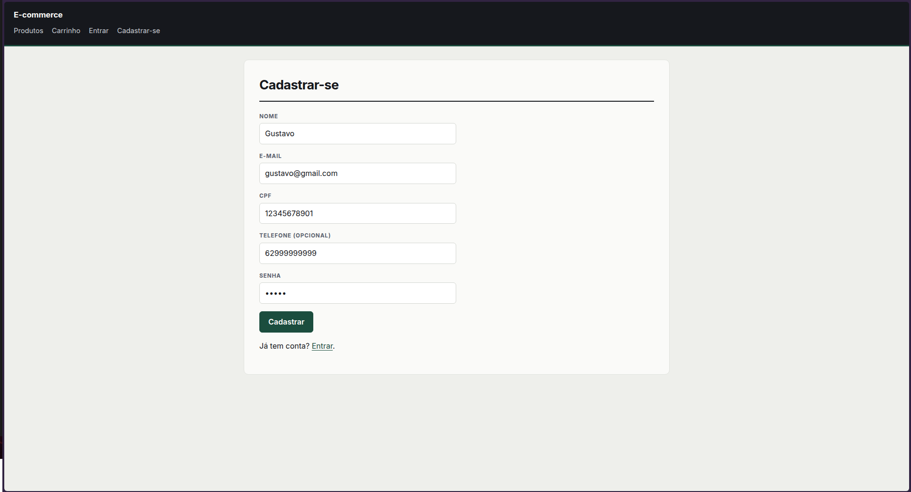
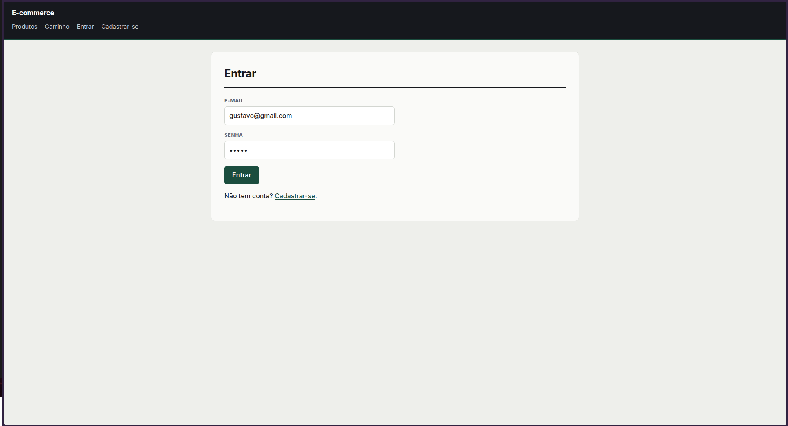
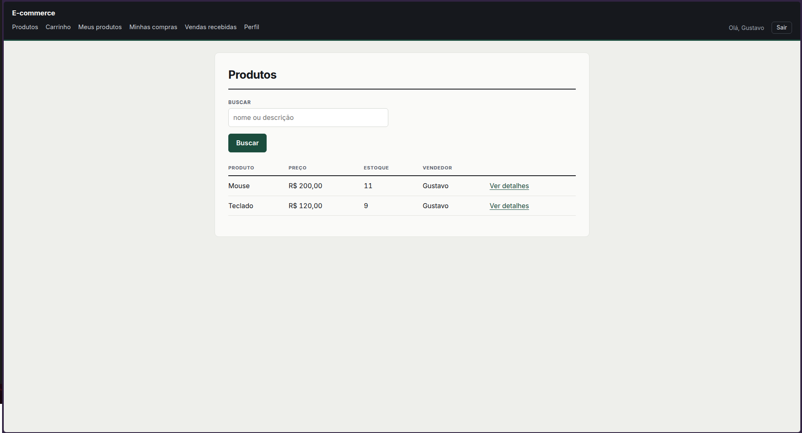
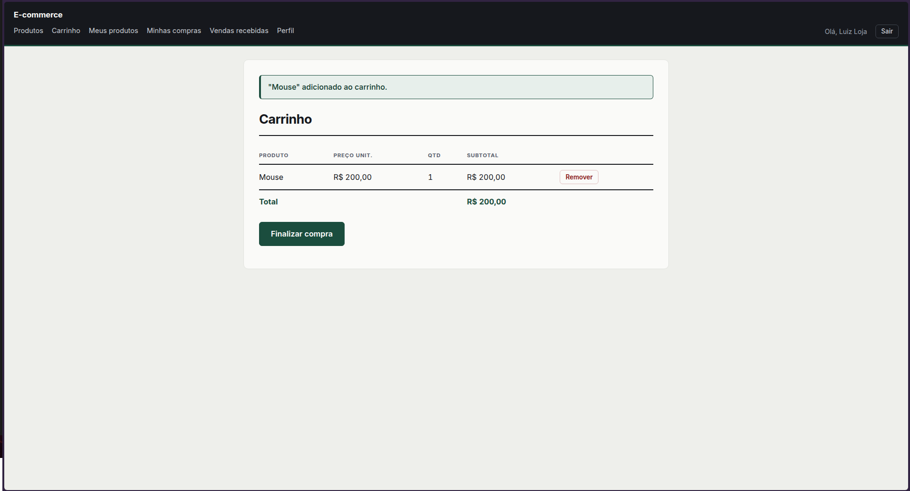
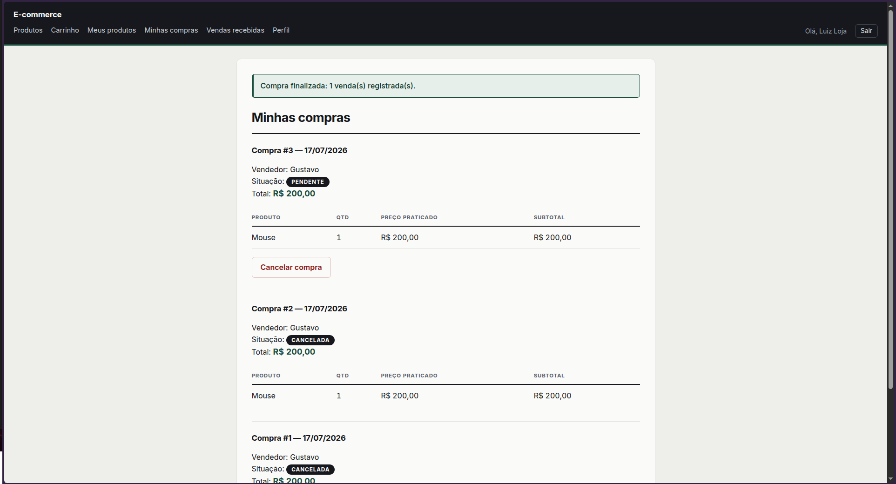
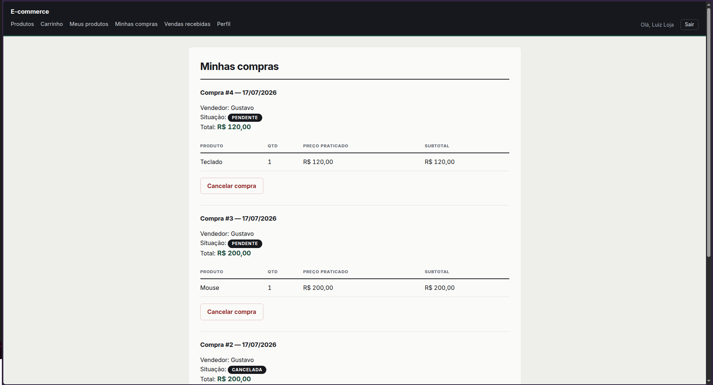
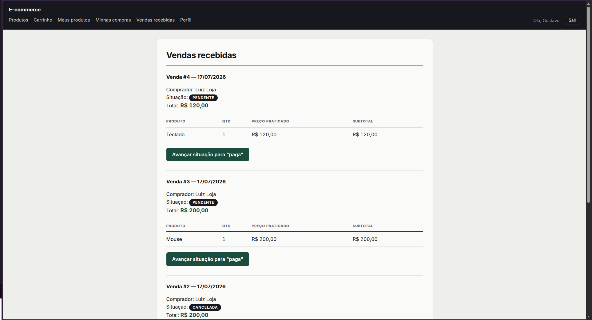

# E-commerce simplificado — Ruby + Sinatra + ActiveRecord

Aplicação web de compra e venda de produtos. Um mesmo usuário pode atuar como
**vendedor** (cadastrando produtos próprios) e como **comprador** (efetuando
compras): o papel é inferido pelas associações, não por um campo de tipo.

* **Sinatra** modular (`class App < Sinatra::Base`)
* **ActiveRecord 8.1** sobre **SQLite**, com migrations
* Páginas em **ERB**, formulários HTML e layout compartilhado com cabeçalho,
  rodapé e mensagens de feedback (sucesso/erro) a cada ação
* Suíte **RSpec** em três camadas: modelo, rotas/controladores e interface

---

## Dependências

| Item | Versão | Observação |
|---|---|---|
| Ruby | **3.2 ou superior** | desenvolvido e testado no Ruby 4.0.5 |
| Bundler | **4.x** | acompanha o Ruby 4.0 (ver *Rodando em outro sistema*) |
| SQLite | — | **não precisa instalar**: a gem `sqlite3` empacota a própria libsqlite3 |

Gems declaradas no `Gemfile` (versões exatas travadas no `Gemfile.lock`):
`sinatra`, `rackup`, `puma`, `sinatra-activerecord`, `activerecord ~> 8.1`,
`sqlite3 ~> 2.1`, `rake`, `bcrypt` e — só em desenvolvimento e teste —
`rspec`, `rack-test` e `capybara`.

## Instalação

bundle install


## Banco de dados

bundle exec rake db:create    # cria db/development.sqlite3 (e o de teste)
bundle exec rake db:migrate   # roda as 4 migrations e gera db/schema.rb

`db:create` e `db:migrate` são seguros de repetir: avisam e não fazem nada se
já estiver tudo criado.


## Iniciar o servidor

bundle exec rackup 

Depois abra <http://localhost:9292>.


## Rodar os testes

**Um único comando roda as três camadas:**

bundle exec rspec

Saída esperada: `120 examples, 0 failures` (~1 segundo).

Não é preciso preparar nada antes: o `spec/spec_helper.rb` apaga o
`db/test.sqlite3` e recarrega o `db/schema.rb` do zero a cada execução.

Para rodar uma camada isolada:

bundle exec rspec spec/models     # 53 exemplos — camada de modelo
bundle exec rspec spec/routes     # 65 exemplos — camada de rotas/controladores
bundle exec rspec spec/features   #  2 exemplos — camada de interface (Capybara)


| Camada | Pasta | O que cobre |
|---|---|---|
| Modelo | `spec/models/` | atributos, as 5 associações do MER, validações de presença/unicidade/formato e as regras de negócio (estoque debitado, `valor_total` calculado, rollback da transação, estorno no cancelamento, fluxo de situação) |
| Rotas e controladores | `spec/routes/` | cada rota da aplicação: código HTTP, destino do redirecionamento e efeito real no banco, incluindo os casos negativos (sem login, produto de outro dono) |
| Interface | `spec/features/` | fluxo de uso real com Capybara: usuário se cadastra, autentica, vendedor publica, comprador compra, vendedor avança a situação até a entrega |

---

## Telas

### Cadastro


### Login


### Listagem de produtos


### Carrinho


### Finalizar compra


### Minhas compras


### Vendas recebidas


---

## Modelo de dados

Quatro entidades, conforme o MER.

**USUARIO** — `id` (PK), `nome`, `email` (UK), `senha_hash`, `cpf`, `telefone`

**PRODUTO** — `id` (PK), `nome`, `descricao`, `preco`, `estoque`,
`vendedor_id` (FK → `usuarios.id`)

**VENDA** — `id` (PK), `comprador_id` (FK → `usuarios.id`),
`vendedor_id` (FK → `usuarios.id`), `data`, `status`, `valor_total`

**ITEM_VENDA** — `id` (PK), `venda_id` (FK → `vendas.id`),
`produto_id` (FK → `produtos.id`), `quantidade`, `preco_unitario`

### Associações

| Relação | Como está no ActiveRecord |
|---|---|
| USUARIO 1—N PRODUTO (*vende*) | `Usuario has_many :produtos, foreign_key: :vendedor_id` |
| USUARIO 1—N VENDA (*vende*) | `Usuario has_many :vendas_como_vendedor, class_name: 'Venda', foreign_key: :vendedor_id` |
| USUARIO 1—N VENDA (*compra*) | `Usuario has_many :compras, class_name: 'Venda', foreign_key: :comprador_id` |
| VENDA 1—N ITEM_VENDA (*contém*) | `Venda has_many :item_vendas, dependent: :destroy` |
| PRODUTO 1—N ITEM_VENDA (*aparece em*) | `Produto has_many :item_vendas, dependent: :restrict_with_error` |

As chaves estrangeiras são reais no banco e o SQLite as aplica
(`PRAGMA foreign_keys = ON`, padrão do ActiveRecord 8): não é possível gravar
referência órfã nem apagar um pai que ainda tem filhos.

### Validações

* **Usuário** — e-mail obrigatório, com formato válido e único (validação no
  ActiveRecord + índice único no banco); CPF e nome obrigatórios; senha nunca
  é gravada em texto puro (BCrypt).
* **Produto** — nome obrigatório; preço maior que zero; estoque inteiro e não
  negativo.
* **Venda** — situação restrita a `pendente`, `paga`, `enviada`, `entregue` ou
  `cancelada`; comprador e vendedor obrigatoriamente **distintos**.
* **Item de venda** — quantidade inteira maior que zero; preço unitário maior
  que zero.

---

## Casos de uso implementados

**Vendedor:** cadastrar produto · editar produto · excluir produto ·
listar meus produtos · ver vendas recebidas · atualizar situação da venda

**Comprador:** buscar produtos · ver detalhes do produto · adicionar ao
carrinho · finalizar compra · listar minhas compras · cancelar compra pendente

**Compartilhado:** cadastrar-se · fazer login · editar perfil

As ações marcadas com «include» *Fazer login* no diagrama (cadastrar produto,
atualizar situação, finalizar compra, cancelar compra) exigem sessão ativa:
sem login, redirecionam para `/login` com mensagem de erro.

## Rotas

| Método | Rota | Acesso |
|---|---|---|
| GET | `/` → redireciona para `/produtos` | público |
| GET | `/produtos` (busca por `?q=`) | público |
| GET | `/produtos/novo` | logado |
| GET | `/produtos/:id` | público |
| POST | `/produtos` | logado |
| GET | `/produtos/:id/editar` | logado + dono |
| POST | `/produtos/:id` | logado + dono |
| POST | `/produtos/:id/excluir` | logado + dono |
| GET | `/meus-produtos` | logado |
| GET | `/cadastro` · POST `/usuarios` | público |
| GET | `/login` · POST `/login` · POST `/logout` | público |
| GET | `/perfil/editar` · POST `/perfil` | logado |
| POST | `/carrinho/itens` · GET `/carrinho` · POST `/carrinho/itens/:produto_id/remover` | público |
| POST | `/carrinho/finalizar` | logado |
| GET | `/minhas-compras` · POST `/compras/:id/cancelar` | logado + comprador da venda |
| GET | `/vendas-recebidas` · POST `/vendas/:id/avancar` | logado + vendedor da venda |

Toda ação que muda estado usa `POST` — nenhum link altera dados.

---

## Decisões de projeto

**1. O carrinho vive na sessão, não no banco.** O diagrama de casos de uso
pede "Adicionar ao carrinho", mas o MER não tem entidade Carrinho e não é
permitido acrescentar entidades. O carrinho é um `Hash` na `session` do
Sinatra (`{ "produto_id" => quantidade }`), então nenhuma tabela nova foi
criada. Ele sobrevive ao login: dá para montar o carrinho deslogado e
autenticar só na hora de finalizar.

**2. Um carrinho com vários vendedores gera uma Venda por vendedor.** O MER
dá a cada Venda um único `vendedor_id`. No checkout, os itens são agrupados
por vendedor e cada grupo vira uma Venda — tudo dentro de **uma única
transação**, que falha inteira se qualquer item não puder ser reservado.

**3. Ninguém compra o próprio produto.** A regra vive no modelo
(`comprador_id != vendedor_id` e uma verificação em `Venda.registrar_compra!`).
A tela apenas esconde o botão e a rota apenas antecipa o erro; quem garante é
o modelo.

**4. A coluna se chama `status`, o rótulo na tela é "Situação".** O enunciado
usa "situação" no texto e `status` no MER — a coluna segue o MER.

**5. Cancelar uma compra estorna o estoque.** O enunciado não especifica o que
acontece com o estoque ao cancelar. **Decidimos estornar**: `Venda#cancelar!`
devolve a quantidade de cada item ao produto e grava `cancelada`, tudo dentro
de uma transação. O cancelamento só é permitido enquanto a venda está
`pendente` — depois de paga, a operação é recusada com mensagem de erro.

**6. Excluir um produto já vendido é bloqueado.** Apagar o produto apagaria em
cascata os `ITEM_VENDA` que o referenciam, destruindo o histórico de compras
de quem já comprou — e o `preco_unitario` registrado na venda perderia
contexto. Por isso `Produto has_many :item_vendas, dependent: :restrict_with_error`:
se o produto já apareceu em alguma venda, a exclusão é recusada com uma
mensagem amigável. Produtos nunca vendidos podem ser excluídos normalmente.

**7. O preço do item é congelado no momento da compra.** `ITEM_VENDA` tem
coluna `preco_unitario` própria, copiada de `PRODUTO.preco` no instante do
checkout. As telas de compras e vendas sempre exibem esse valor, nunca o preço
atual do produto — se o vendedor reajustar o preço depois, a compra antiga
continua mostrando o que foi efetivamente pago.

**8. Regra de negócio no modelo, não na rota.** `Venda.registrar_compra!`,
`Venda#cancelar!` e `Venda#avancar_status!` concentram as regras e levantam
`Venda::ErroDeCompra`. As rotas apenas chamam, dão `rescue` e escolhem a
mensagem de feedback.

**9. `created_at`/`updated_at` nas quatro tabelas.** Não estão no MER, mas o
enunciado permite atributos opcionais e `t.timestamps` é convenção do
ActiveRecord.

---

## Estrutura do projeto

```
.
├── Gemfile / Gemfile.lock      # dependências
├── Rakefile                    # tasks db:create, db:migrate...
├── config.ru                   # ponto de entrada Rack
├── app.rb                      # Sinatra modular: helpers e rotas
├── config/database.yml         # SQLite: development e test
├── models/                     # Usuario, Produto, Venda, ItemVenda
├── db/
│   ├── migrate/                # as 4 migrations, na ordem de dependência
│   └── schema.rb               # gerado pelo db:migrate
├── views/
│   ├── layout.erb              # cabeçalho, rodapé e mensagens de feedback
│   ├── usuarios/  sessoes/  produtos/  carrinho/  compras/  vendas/
├── spec/
│   ├── spec_helper.rb
│   ├── support/                # fábricas e helper de login
│   ├── models/                 # camada 1
│   ├── routes/                 # camada 2
│   └── features/               # camada 3
├── docs/prints/                # prints das telas
└── README.md
```

---

## Rodando em outro sistema (Windows / macOS)

O `Gemfile.lock` já contempla as plataformas Windows (`x64-mingw-ucrt`), macOS
e Linux, então o `bundle install` resolve sem precisar reescrever o lock.

Dois pontos que podem aparecer:

* **Ruby anterior ao 3.2** — o ActiveRecord 8.1 exige Ruby 3.2 ou superior e o
  `bundle install` falha. É preciso atualizar o Ruby.
* **Bundler anterior ao 4** — este `Gemfile.lock` foi gerado pelo Bundler 4 e
  traz uma seção `CHECKSUMS` e a linha `BUNDLED WITH 4.0.x`. O Bundler troca
  sozinho para a versão indicada; se ele reclamar que não a encontra, basta
  `gem install bundler:4.0.10` (ou a versão que estiver no fim do
  `Gemfile.lock`) e repetir o `bundle install`.